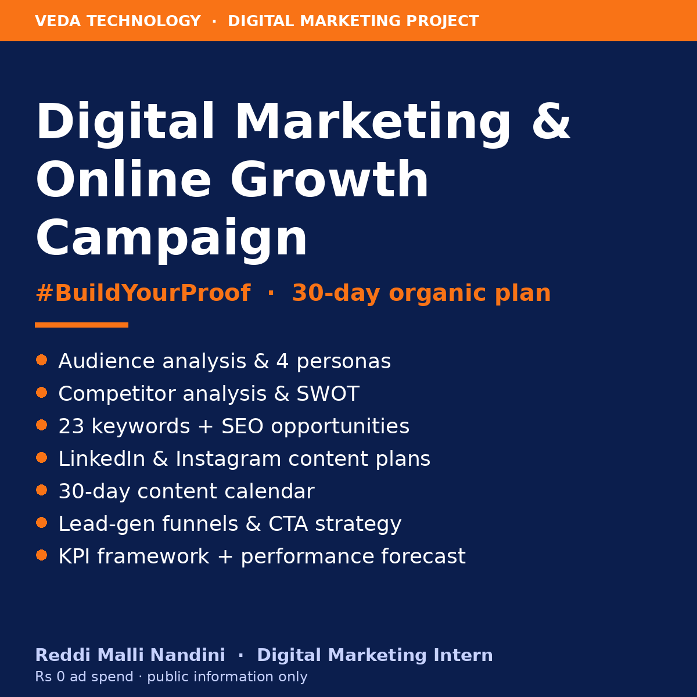

# 🚀 Veda Technology Digital Marketing & Online Growth Campaign



> **#BuildYourProof** — a complete 30-day organic digital marketing campaign for **Veda Technology**, covering its technology & digital services, training programs and internship opportunities.

| | |
|---|---|
| **Intern** | Reddi Malli Nandini |
| **Internship** | Digital Marketing — Veda Technology (Level 1) |
| **Project** | Veda Technology Digital Marketing & Online Growth Campaign |
| **Duration** | 4-day project |
| **Ad budget** | ₹0 — organic channels only |

---

## 🎯 Objective

Gain practical experience in planning and managing digital marketing for a real technology and service-oriented brand, and show how **SEO, social media, content marketing, lead generation and website promotion** work together as one system.

## 💡 Campaign idea in one line

Veda Technology's certificates **prove output, not attendance** — so the campaign turns intern projects, mentor feedback and certificate verification into visible proof, spread through LinkedIn, Instagram and Facebook, and converts that trust into **internship applications** and **service enquiries**.

---

## ✅ Deliverables

| # | Deliverable | File |
|---|---|---|
| 1 | Veda Technology audience analysis | [01-audience-analysis.md](deliverables/01-audience-analysis.md) |
| 2 | Target audience personas (students, graduates, businesses, service customers) | [02-target-audience-personas.md](deliverables/02-target-audience-personas.md) |
| 3 | Service-wise audience mapping | [03-service-wise-audience-mapping.md](deliverables/03-service-wise-audience-mapping.md) |
| 4 | Competitor analysis + SWOT | [04-competitor-analysis.md](deliverables/04-competitor-analysis.md) |
| 5 | Keyword research | [05-keyword-research.md](deliverables/05-keyword-research.md) |
| 6 | SEO content opportunities | [06-seo-content-opportunities.md](deliverables/06-seo-content-opportunities.md) |
| 7 | Social media strategy | [07-social-media-strategy.md](deliverables/07-social-media-strategy.md) |
| 8 | LinkedIn content plan | [08-linkedin-content-plan.md](deliverables/08-linkedin-content-plan.md) |
| 9 | Instagram content plan | [09-instagram-content-plan.md](deliverables/09-instagram-content-plan.md) |
| 10 | 30-day Veda Technology content calendar | [10-30-day-content-calendar.md](deliverables/10-30-day-content-calendar.md) |
| 11 | Website content recommendations | [11-website-content-recommendations.md](deliverables/11-website-content-recommendations.md) |
| 12 | Lead-generation campaign | [12-lead-generation-campaign.md](deliverables/12-lead-generation-campaign.md) |
| 13 | Call-to-action strategy | [13-call-to-action-strategy.md](deliverables/13-call-to-action-strategy.md) |
| 14 | Campaign KPI framework | [14-campaign-kpi-framework.md](deliverables/14-campaign-kpi-framework.md) |
| 15 | Expected performance analysis | [15-expected-performance-analysis.md](deliverables/15-expected-performance-analysis.md) |
| 16 | **Complete digital marketing campaign report (PDF)** | [report/Veda_Technology_Digital_Marketing_Campaign_Report.pdf](report/Veda_Technology_Digital_Marketing_Campaign_Report.pdf) |
| ➕ | Campaign workbook (calendar with auto-dates, keywords, KPIs, formula-driven forecast, lead tracker) | [data/Veda_Technology_Campaign_Workbook.xlsx](data/Veda_Technology_Campaign_Workbook.xlsx) |

---

## 📁 Repository structure

```
veda-technology-digital-marketing-campaign/
├── README.md
├── assets/
│   └── campaign-cover.png
├── data/
│   └── Veda_Technology_Campaign_Workbook.xlsx
├── deliverables/
│   ├── 01-audience-analysis.md
│   ├── 02-target-audience-personas.md
│   ├── ... (03 – 14)
│   └── 15-expected-performance-analysis.md
└── report/
    └── Veda_Technology_Digital_Marketing_Campaign_Report.pdf
```

---

## 🔑 Key highlights

- **4 personas:** Priya (first-internship student), Arjun (job-ready fresher), Ramesh (local business owner), Sneha (startup/SME decision-maker).
- **5 content pillars:** Learn · Proof · Career · Business · Brand — value-first, with only a small share of direct promotion.
- **Intern advocacy engine:** every intern already posts on LinkedIn, so a shared template + `#VedaTechnologyIntern` turns submissions into free brand reach.
- **Two organic lead funnels:**
  - 🎓 Students → free *Fresher Project Kit* + live session *"From Zero to Internship"* → Apply page
  - 🏢 Businesses → free *10-Point Website Health Check* → quote / call
- **23 keywords** grouped by intent (internships, track pages, trust, career guidance, services, local).
- **Website quick win:** homepage stats render as "0+" without JavaScript — show real numbers or remove the section.
- **Measurement:** UTM links on every post, Google Sheets lead log, weekly KPI review.

## 📊 Expected performance (30 days, realistic scenario)

| Metric | Estimate |
|---|---|
| Total social reach | ~42,400 |
| Website visits (social + search) | ~660 |
| Internship applications | ~45 |
| Lead-magnet sign-ups | ~110 |
| Business enquiries | ~6 |

*Planning estimates using organic reach only; conservative and optimistic scenarios are in the workbook.*

---

## 🛠️ Tools used

Google Sheets / Excel · Canva · Google Trends · Keyword research tools · Google Search Console concepts · Google Analytics concepts · LinkedIn · Instagram · Facebook · Google Docs

## ⚠️ Guidelines followed

- Only **publicly available** Veda Technology information was used (source: [vedatechnology.in](https://vedatechnology.in/)).
- No services, certifications or partnerships are claimed beyond what Veda Technology officially lists.
- Covers **both** technology/digital services and student-focused training/internship offerings.
- Uses Veda Technology's **navy and orange** branding.
- Planned as a realistic business campaign with **no paid advertising**.
- Keyword demand and performance figures are clearly marked as **estimates** to be validated with real tool data.

---

## 👤 Author

**Reddi Malli Nandini** — Digital Marketing Intern, Veda Technology

`#VedaTechnologyIntern` `#BuildYourProof` `#DigitalMarketing`
